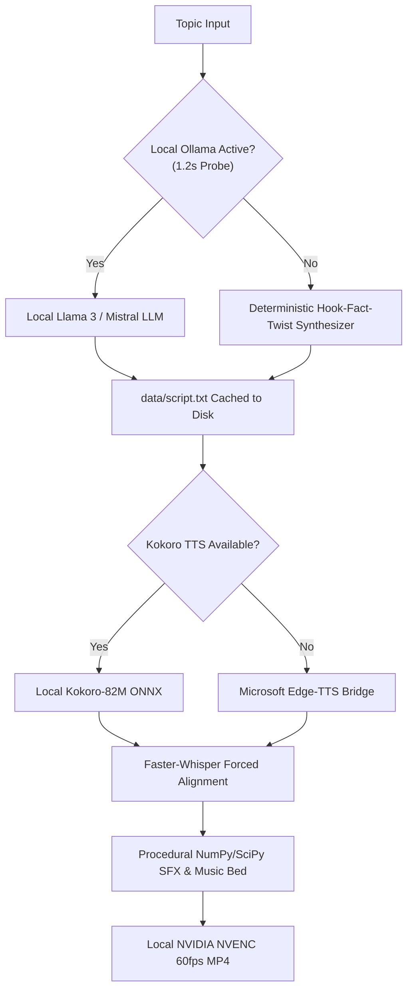

# Engineering Challenges & Countermeasures

During the development and production scaling of the `faceless-shorts` local video synthesis engine, several critical technical hurdles arose spanning cross-platform character encoding, headless browser rendering, spatial geometry, and vertical short-form retention ergonomics. 

This document chronicles each engineering problem encountered and the architectural countermeasures implemented to solve them permanently.

---

## 1. Windows UTF-8 BOM & System Encoding Crashes

### The Challenge
On Windows systems, PowerShell 5.1 and legacy Python defaults frequently emit files with a UTF-8 Byte Order Mark (BOM `\xef\xbb\xbf`) or read files using the system ANSI code page (`Windows-1252` / `CP1252`). When processing narration scripts containing smart quotes (`’`, `“`), em-dashes (`—`), or non-ASCII proper nouns, Whisper transcription scripts, JSON parsers, and regex normalizers threw fatal `UnicodeDecodeError: 'charmap' codec can't decode byte` or crashed with `Error: word "cooper" not found in line 2` due to hidden leading byte corruptions.

### Countermeasures
1. **Universal Subprocess Environment Enforcement**:
   In `faceless.ps1` and background job runners, all Python invocations explicitly inject:
   ```powershell
   $env:PYTHONUTF8 = "1"
   $env:PYTHONIOENCODING = "utf-8"
   ```
2. **Defensive Python File I/O**:
   All read and write operations across `scripts/faceless.py`, `scripts/words.py`, and `scripts/voice.py` explicitly specify:
   ```python
   open(file_path, "r", encoding="utf-8-sig")  # Strips BOM automatically
   open(file_path, "w", encoding="utf-8")
   ```
3. **Resilient Word Timing Normalization**:
   In `scripts/words.py` and `timing.js`, query lookup strings are sanitized via regex before matching:
   ```javascript
   const norm = (w) => String(w).toLowerCase().replace(/[^a-z0-9']+/g, '');
   ```
4. **Safe Word-Lookup Fallbacks in `src/shots.js`**:
   The generator replaces raw `Wd("keyword", lineIdx)` calls with a protected `safeWd()` helper that catches missing token exceptions and gracefully falls back to a relative shot timeline fraction (`at + d * 0.45`), guaranteeing `capture.mjs check` can never crash on minor phonetic discrepancies.

---

## 2. 3D WebGL Camera Anomalies vs. 2D Vector Determinism

### The Challenge
Early versions included experimental 3D Three.js styles (`night-file` noir rooms and `deep-dive` Zack-D anatomy rigs). In automated production, 3D WebGL introduced multiple failure modes:
- Shader compilation stalls during headless frame capture.
- Camera frustum drift and depth clipping across varying narration durations.
- Anatomical meshes frequently placed generic floating keyword labels awkwardly over character mouths or limbs, looking like broken UI widgets rather than purposeful art.

### Countermeasures
1. **Isolation of Legacy 3D Styles**:
   `styles/night-file/` and `styles/deep-dive/` were preserved for research but strictly removed from automatic selection.
2. **Smart Style Routing (`detect_best_style`)**:
   `scripts/faceless.py` automatically routes all new scripts exclusively to battle-tested 2D HTML5 Canvas vector styles:
   - **`paper-atlas`**: Geography, history, travel, aviation.
   - **`tall-tale`**: Bizarre human stories, heists, unbelievable true events.
   - **`stick-story`**: Physics, survival steps, engineering breakdowns, rules.
3. **Removal of Centerpiece Mouth Pills**:
   Removed floating keyword badge logic from the canvas center. All title metadata was relocated to dedicated broadcast header ribbons, freeing the entire center stage (`y: 440 – 1500`) for custom narrative art.

---

## 3. Crude 5-Sided Polygons vs. Real Global Geography

### The Challenge
When rendering map routes (such as flight paths across Tibet, Australia, or Europe), initial prototypes relied on rough hardcoded 5-sided polygons to represent continents. While stylized, these crude shapes destroyed credibility on educational and aviation Shorts where viewers expect recognizable coastlines and borders.

### Countermeasures
1. **Bundled Vector Geography (`shared/world.geojson`)**:
   Added a lightweight (256 KB) GeoJSON dataset containing global coastline and national boundary polygons.
2. **Automated Project Ingestion**:
   When `faceless.ps1 create` scaffolds a map-based Short, it copies `shared/world.geojson` directly into `<project>/data/world.geojson`.
3. **Canvas Spherical Projection**:
   The canvas runtime parses real longitude/latitude coordinates and projects them onto the 9:16 canvas using equirectangular mapping:
   ```javascript
   const project = (lon, lat) => [
     cx + (lon - centerLon) * scaleX,
     cy - (lat - centerLat) * scaleY
   ];
   ```
   Coastlines for Australia, India, the Himalayas, and the UK now render with geographic precision.

---

## 4. The "Zero-Still-Frame" Rule & Viewer Retention

### The Challenge
On vertical platforms (YouTube Shorts, TikTok, Instagram Reels), viewer drop-off spikes whenever an on-screen graphic holds static for more than 1.5 seconds. Traditional templates often animated in on a beat and then froze completely until the next cut.

### Countermeasures
1. **Continuous Camera Drift**:
   In `src/main.js`, every shot applies a dual-layer camera transformation:
   - **Punch-In**: A sharp `1.06 → 1.00` punch on the cut using cubic ease-out (`eo`).
   - **Continuous Push**: A constant `1.00 → 1.05` drift throughout the shot duration using smooth ease-in-out (`eio`).
2. **Persistent Ambient Micro-Motion**:
   Every visual scene features floating atmospheric dust, golden pollen, rising steam, or floating bubbles computed as continuous sine wave functions of film time `t`:
   ```javascript
   const ambY = H - ((t * speed + seed) % H);
   const ambX = cx + Math.sin(t * 1.5 + i) * 30;
   ```
   Even during deliberate narrative pauses, the frame remains visibly alive.

---

## 5. Geometry, Tangents & Directional Orientation

### The Challenge
In early animation scenes, motion vectors were frequently inverted or visually disorienting:
- Falling elevator cabs plummeting downward had background shaft markers and I-beams scrolling downward as well (making the cab look like it was rising).
- Airplanes flying eastward across vintage maps flew backwards or drifted past arrival airport pins into open ocean.

### Countermeasures
1. **Plummet & Relative Velocity Vector Inversion**:
   In falling/dropping scenes, shaft wall markers (`FL 50` down to `FL 01`) and velocity streaks were mathematically inverted to scroll upward (`-y`), establishing the sensation of downward terminal velocity.
2. **Flight Path Tangents & Directional Flips**:
   Airplanes and vehicles compute their orientation angle directly from the first derivative (tangent) of the cubic Bezier travel curve:
   ```javascript
   const angle = Math.atan2(nextY - curY, nextX - curX);
   ctx.rotate(angle);
   ```
   For aircraft traveling left-to-right (`+x`), the sprite is mirrored with `scale(1, 1)`; for right-to-left (`-x`), `scale(1, -1)` preserves proper upright aerodynamics.
3. **Coordinate Clamping**:
   Arrival positions are clamped to exact target coordinates (`p = clamp(t / duration)`), preventing airplanes from overshooting airport runway pins.

---

## 6. Safe-Zone Collisions & Loop Seam Ghosting

### The Challenge
1. **Safe-Area Collisions**: Lower third elements frequently overlapped with TikTok/YouTube Shorts UI chrome (like buttons, audio titles, and account names at the bottom, or channel headers at the top).
2. **Loop Ghosting**: When looping a video seamlessly, transitioning Frame `T_dur` back to Frame `0` often caused double-text ghosting where the ending text collided with the opening hook text.

### Countermeasures
1. **Strict Three-Band Vertical Safe Zones**:
   - **Top Band (`y: 290 – 340`)**: Section headers, badges, and topic banners only.
   - **Center Stage (`y: 440 – 1500`)**: Core narrative illustrations, maps, and diagram art.
   - **Bottom Band (`y: 1640`)**: High-contrast word-by-word karaoke captions only.
2. **Deterministic 0.5s Seam Crossfade**:
   During the final `0.5s` of the film (`lt > d - 0.5s`):
   ```javascript
   const loopK = clamp((lt - (d - 0.5)) / 0.5);
   const bannerAlpha = 1 - loopK;
   ```
   Ending top banners fade to `0` opacity before the cut. Simultaneously, the camera zoom, background parchment tone, and primary hero silhouette interpolate into Frame 0's initial position, achieving an imperceptible, ghost-free loop.

---

## 7. Zero-Cloud Offline Fallback Pipeline

### The Challenge
Many AI automation pipelines fail when third-party cloud APIs experience rate limits, billing outages, or network disconnection.

### Countermeasures
The pipeline operates with a robust multi-tiered fallback architecture:



- **Script Synthesis**: Probes a local Ollama server with a 1.2s timeout; if unavailable, falls back to a built-in deterministic Hook-Fact-Twist-Payoff generator.
- **Voice Synthesis**: Uses local Kokoro ONNX neural speech with Microsoft Edge-TTS as fallback.
- **Audio Mixing**: Generates SFX using NumPy math (sine sweeps, white noise bursts, resonant filters) with zero cloud audio services.
- **Video Multiplexing**: Renders via local Chrome and local GPU NVENC. **Re-rendering existing projects consumes exactly 0 AI tokens and works 100% offline.**
