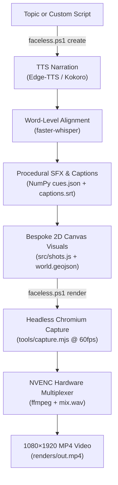

# Faceless Shorts 🎬⚡

> **Local-First, High-Retention 9:16 Video Synthesis Engine**  
> Generate complete 1080×1920 vertical YouTube Shorts, Instagram Reels, and TikToks directly on your workstation—100% in code. Zero AI video APIs, zero cloud credits, and zero per-render costs.

---

## ⚡ Highlights

- **Local Hardware Acceleration**: Renders at 60fps using NVIDIA NVENC (`h264_nvenc`) via headless Chromium frame capture and FFmpeg audio-visual multiplexing.
- **Beat-Synced Dynamic Motion**: Automated alignment from audio waveform to Whisper word timestamps down to the millisecond. Every cut, transition, and lower third hits precisely on narration beats.
- **2D Canvas Physics & GeoJSON Maps**: Dynamic vector rendering using HTML5 2D Canvas, equirectangular map projection from bundled `world.geojson`, procedural particle systems, and continuous camera drift.
- **Procedural Audio Architecture**: Synthesizes and layers whooshes, pops, mechanical tocks, and background audio beds procedurally using NumPy and SciPy.
- **Zero-Cloud Re-Render Freedom**: After script generation and word alignment, video renders require **zero AI tokens** and run completely offline in seconds.
- **Decoupled Integration Surface**: Standardized project layout (`data/YYYY-MM-DD/<slug>/`) consumable by any external manager, UI, or queue runner.

---

## 🏗️ Architecture Pipeline



---

## 🚀 Quick Start CLI

Execute all commands from PowerShell at the repository root:

### 1. Environmental Doctor Check
Inspect all required system binaries, GPU hardware encoders, Node.js runtime, and Python dependencies:
```powershell
.\faceless.ps1 doctor
```

### 2. One-Line Creation & Rendering
Generate a complete, high-retention Short from a premise in a single command:
```powershell
.\faceless.ps1 create --topic "Why Planes Don't Fly Over Tibet" --style paper-atlas --render
```
*If `--script` is omitted, the engine automatically synthesizes a punchy 7–9 sentence high-retention script.*

### 3. Create Draft Only (Inspect Before Render)
Create the project, generate narration audio, compute Whisper word alignments, and build `src/shots.js`:
```powershell
.\faceless.ps1 create --topic "The Man Who Mailed Himself in a Wooden Box" --style tall-tale
```

### 4. Render or Re-Render an Existing Project
Re-render any project directory after customizing `src/shots.js`:
```powershell
.\faceless.ps1 render "data/2026-11-25/why-honey-never-spoils"
```

---

## 🎨 Visual Animation Styles

The engine standardizes on high-contrast, deterministic 2D vector styles:

| Style | Aesthetic & Theme | Centerpiece Features | Auto-Selected For |
| :--- | :--- | :--- | :--- |
| **`paper-atlas`** | Vintage aged parchment, cut-paper drop shadows, warm sepia, crimson routes | Real coastlines from `world.geojson`, animated flight arcs, compass roses, passport stamps | Geography, trade routes, aviation, historical events |
| **`tall-tale`** | Stylized 2D cut-out illustrations on textured parchment, bold silhouettes | Kinetic travel arcs, animated props (wooden crates, ships, dials), character vignettes | Bizarre true stories, legendary heists, survival feats |
| **`stick-story`** | High-energy kinetic line art, blueprint grids, amber/crimson callout badges | Numbered countdown slates (#3 → #2 → #1), progress meters, warning icons, system diagrams | Science explainers, engineering, countdowns, rules |

### Note on 3D Styles (`night-file` & `deep-dive`)
Legacy experimental 3D WebGL styles (`night-file` and `deep-dive`) are strictly isolated and excluded from auto-selection. Because WebGL camera projection and 3D rig meshes can introduce drift and platform-dependent shader anomalies, all automated and high-retention production targets the battle-tested 2D Canvas pipeline.

---

## 📐 Safe-Zone & Retention Rules

Every shot adheres to strict vertical short-form broadcast standards:
- **Top Safe Zone (`y: 290 – 340`)**: Dedicated exclusively to section headers and badges. Never collides with center stage artwork.
- **Center Stage Art (`y: 440 – 1500`)**: Primary visual diagrams, maps, and character animations live here.
- **Bottom Caption Safe Zone (`y: 1640`)**: Reserved for word-by-word karaoke subtitles (karaoke active-word highlights).
- **The "Zero-Still-Frame" Rule**: Continuous camera drift (`scale: 1.00 → 1.05`) and ambient background micro-motion (`Math.sin` oscillations) ensure viewer retention never dips from frozen frames.
- **Seamless 0.5s Loop Seams**: During the final `0.5s`, top overlays cleanly fade out (`1 - loopK`) while Frame 0 attributes interpolate in (`loopK`), preventing double-text ghosting when looped on mobile feeds.

---

## 🔌 External Dashboard & Automation Boundary

The pipeline is intentionally decoupled from external dashboards, web interfaces, and queue runners. Any external tool (such as [Stream Clips](file:///D:/AI-Projects/stream-clips)) can control the pipeline using the standardized interface:

### 1. Environment Configuration
Point external runners to this repository:
```bash
export FACELESS_SHORTS_DIR="D:/AI-Projects/faceless-shorts-skill/faceless-shorts"
```

### 2. Standardized Output Layout
Generated projects are placed in a predictable date-stamped directory:
```text
data/
└── YYYY-MM-DD/
    └── <slug>/
        ├── data/
        │   ├── script.txt       # Raw narration text
        │   ├── lines.json       # Sentence-level timestamps
        │   ├── words.json       # Whisper millisecond word timings
        │   ├── captions.srt     # Synchronized SRT subtitles
        │   ├── narration.wav    # Master voice narration
        │   └── mix.wav          # Narration + procedural SFX mix
        ├── src/
        │   └── shots.js         # Beat-synced 2D Canvas visual script
        ├── renders/
        │   └── out.mp4          # Final 1080×1920 60fps NVENC video
        ├── script.json          # Caption line-break and accent markers
        └── index.html           # Project HTML5 canvas testbed
```

---

## 📜 Documentation Suite

- [STRUCTURE.md](file:///D:/AI-Projects/faceless-shorts-skill/faceless-shorts/STRUCTURE.md): Exhaustive directory tree and file-by-file breakdown.
- [CHALLENGES.md](file:///D:/AI-Projects/faceless-shorts-skill/faceless-shorts/CHALLENGES.md): Deep-dive into technical hurdles (Windows UTF-8 BOM, orientation math, GeoJSON mapping, seamless loop crossfades) and engineering countermeasures.
- [SETUP.md](file:///D:/AI-Projects/faceless-shorts-skill/faceless-shorts/SETUP.md): Prerequisites, GPU driver configuration, and environment setup.
- [PIPELINE_DOCS.md](file:///D:/AI-Projects/faceless-shorts-skill/faceless-shorts/PIPELINE_DOCS.md): Reference manual covering installed agent skills and animation easing patterns.

---

## 📄 License

Original code, styles, sound engines, and drawing primitives are licensed under the MIT License. Embedded Inter font is licensed under SIL Open Font License 1.1.
